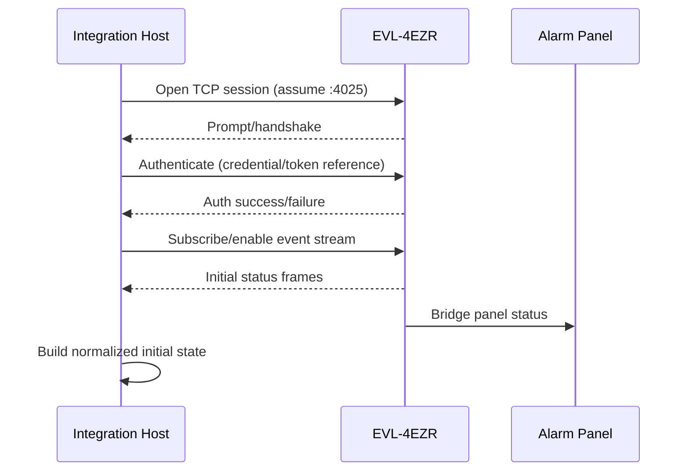
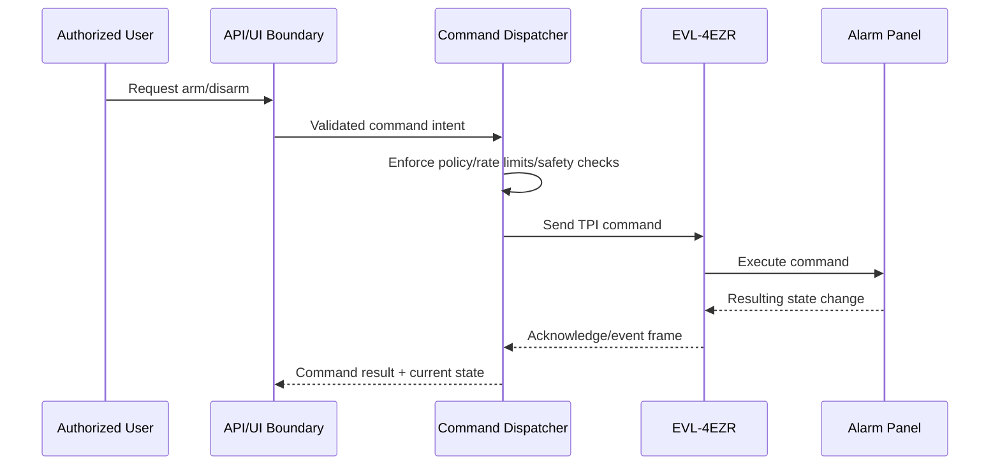

# High-Level Design (HLD): Home Security Integration with EyezOn EnvisaLink EVL-4EZR

## 1. Status and Scope

This document defines a **proposed target architecture** for this repository.

- The repository currently has no implementation code, runtime, or deployment artifacts.
- All technical details below are design assumptions for validation during implementation.
- The EVL-4EZR role as a local TCP/IP TPI boundary (commonly on local port `4025`) is based on publicly available vendor/integration guidance and should be re-validated against current device firmware and documentation before build-out.

---

## 2. Goals and Non-Goals

### Goals

1. Integrate a compatible DSC or Honeywell panel via EyezOn EnvisaLink EVL-4EZR.
2. Observe panel/partition/zone state with event-driven updates.
3. Support controlled arm/disarm command handling.
4. Capture and distribute alarm/security events to user-facing channels.
5. Maintain connectivity and recover safely from transient failures.
6. Provide auditable operational history for actions and critical events.

### Non-Goals

1. Replacing UL-listed panel behavior or life-safety hardware controls.
2. Replacing professionally monitored emergency response service.
3. Bypassing panel-side safety restrictions or installer programming requirements.
4. Defining low-level protocol parsing specifics beyond architectural boundaries.

---

## 3. Assumptions

| ID | Assumption |
|---|---|
| A1 | A compatible DSC or Honeywell panel is already installed and functional. |
| A2 | EVL-4EZR is connected to the panel and reachable on the home LAN. |
| A3 | Local TCP/TPI access is available (commonly port `4025`), subject to firmware validation. |
| A4 | A self-hosted runtime exists (dedicated integration service and/or Home Assistant host). |
| A5 | Home LAN is trusted-but-not-fully-trusted; segmentation and credential hygiene are required. |
| A6 | Notifications may be routed to optional third-party channels (mobile push, messaging, email). |

---

## 4. Actors and Key Use Cases

### Actors

- **Homeowner/User**: Views status, arms/disarms, receives notifications.
- **Alarm Panel**: Source of truth for physical security state.
- **EVL-4EZR**: Panel-to-IP bridge exposing local TCP/TPI interface.
- **Integration Host**: Local service and/or Home Assistant instance.
- **Notification Service** (optional): Delivers outbound alerts.

### Key Use Cases

1. Observe panel and zone state in near real time.
2. Arm/disarm partitions from authorized client paths.
3. Receive and process alarm/tamper/trouble events.
4. Notify users with context-rich and deduplicated alerts.
5. Detect connectivity loss, degrade safely, and recover automatically.

---

## 5. System Context

```mermaid
flowchart LR
    subgraph Home[Home LAN]
      U[User Clients\nMobile/Web UI]
      HA[Home Assistant or\nLocal Integration Service]
      EVL[EyezOn EnvisaLink EVL-4EZR\nTCP/TPI Boundary\n(assume local port 4025)]
      PANEL[DSC/Honeywell Alarm Panel]
    end

    subgraph Optional[Optional External Services]
      NTFY[Push/SMS/Email/Automation Endpoints]
    end

    U <-- API/UI --> HA
    HA <-- TCP/TPI Session --> EVL
    EVL <-- Keybus/Bus --> PANEL
    HA --> NTFY
```

### Boundary Notes

- **Panel boundary**: Physical security authority remains with panel hardware and programming.
- **EVL boundary**: Protocol and session boundary between local IP clients and panel bus semantics.
- **Integration boundary**: Business logic, state model, command policy, notifications, observability.

---

## 6. Logical Architecture and Component Responsibilities

| Component | Responsibility |
|---|---|
| EVL Connection/Session Manager | Establish TCP session, authenticate, maintain keepalive, reconnect with bounded backoff. |
| Protocol Adapter | Translate EVL/TPI inbound/outbound frames into normalized domain events and commands. |
| State/Event Model | Maintain in-memory current state (panel/partition/zone/connection) and emit state changes. |
| Command Dispatcher | Validate and route arm/disarm requests; enforce policy and safe command gating. |
| Persistence/Event History | Store event/audit records and recent state snapshots for troubleshooting and history. |
| Notification Adapter | Map important domain events to user notifications and automation hooks. |
| API/UI Boundary | Expose read/query and command endpoints for local UI/client consumers. |
| Health Monitoring | Report liveness/readiness, stale-state indicators, and connectivity quality metrics. |
| Configuration/Secrets | Load and validate non-secret config and protected credentials/alarm-code references. |

---

## 7. Important Flows

### 7.1 Startup and Authentication



### 7.2 Inbound Zone/Alarm Event Handling

1. EVL forwards panel-originated zone/alarm/trouble updates.
2. Protocol Adapter parses frame and maps it into a typed domain event.
3. State/Event Model updates state atomically and marks freshness timestamp.
4. Persistence writes event/audit record.
5. Notification Adapter evaluates policy (severity, partition, quiet hours, dedup window).
6. API/UI boundary publishes updated state to clients.

### 7.3 Arm/Disarm Command Handling



### 7.4 Reconnect and Keepalive

1. Session Manager emits periodic keepalive/probe.
2. On timeout or socket error, state becomes `DEGRADED` then `OFFLINE` if threshold exceeded.
3. Reconnect loop uses bounded exponential backoff with jitter.
4. On reconnect success, host re-authenticates, resubscribes, and refreshes baseline state.

### 7.5 Degraded/Offline Behavior

- Commands requiring panel connectivity are rejected or queued according to policy (default: reject with explicit reason).
- UI exposes stale-state banners with last-known update timestamp.
- Notifications continue for integration-health events (offline/recovered).
- No synthetic "safe" assumptions are made about disarmed/secure state while offline.

---

## 8. Concise Domain Model

| Entity | Key Fields |
|---|---|
| Panel | `panel_id`, `vendor`, `firmware`, `overall_state`, `last_seen_at` |
| Partition | `partition_id`, `armed_state`, `alarm_state`, `ready`, `last_changed_at` |
| Zone | `zone_id`, `name`, `zone_type`, `open_closed`, `bypass`, `last_changed_at` |
| Event | `event_id`, `source`, `type`, `severity`, `partition_id?`, `zone_id?`, `occurred_at`, `payload` |
| Command | `command_id`, `type` (`ARM_AWAY`,`ARM_STAY`,`DISARM`), `target_partition`, `requested_by`, `status`, `issued_at` |
| Connection State | `status` (`CONNECTED`,`DEGRADED`,`OFFLINE`,`RECONNECTING`), `last_successful_io`, `retry_count` |
| Audit Record | `audit_id`, `actor`, `action`, `result`, `reason`, `correlation_id`, `timestamp` |

---

## 9. Security Design

1. **Trust boundaries**: Treat home LAN as constrained trust; isolate EVL/panel traffic on private VLAN/subnet where feasible.
2. **Credential handling**: Store EVL credentials and alarm codes only in secret storage (env/secret manager), never in source control or logs.
3. **Least privilege**: Separate read-only status clients from command-capable clients.
4. **Encryption considerations**: Validate whether EVL local transport is plaintext/TLS-capable in current firmware; if plaintext, prioritize LAN isolation and endpoint hardening.
5. **Auditability**: Every command attempt and security-significant event must be audit logged with actor and outcome.
6. **Rate limiting**: Apply command cooldowns and per-actor rate limits to reduce accidental/abusive command bursts.
7. **Safe command behavior**: Require explicit target partition and command type; reject ambiguous requests and disallow unsafe retries.
8. **Life-safety statement**: This integration is **not** a replacement for professionally monitored life-safety and emergency response service.

---

## 10. Reliability and Operability Requirements

- Event-driven state updates, not polling-only design.
- Keepalive heartbeat with explicit timeout thresholds.
- Bounded retries with exponential backoff + jitter.
- Idempotency/deduplication for repeated frames and notifications.
- Stale-state indicators and "last update" timestamps surfaced to clients.
- Health endpoints: liveness, readiness, dependency status.
- Structured logs with correlation IDs and severity levels.
- Metrics: connection uptime, reconnect count, event throughput, command success/failure, notification latency.
- Backup/restore: preserve configuration and event/audit history with documented restore flow.

---

## 11. Deployment Topology (Small Self-Hosted)

### Recommended Topology

- One local host (mini-PC/NAS/RPi) on home LAN runs integration service or Home Assistant.
- EVL-4EZR remains on same private network segment as host.
- User clients access local UI/API over trusted network/VPN.
- Optional outbound notifications traverse internet from integration host.

### Example Configuration (Placeholders Only)

```yaml
ev4:
  host: "<EVL_LAN_IP>"
  port: 4025
  username: "<EVL_USERNAME>"
  password_secret_ref: "<SECRET_REF_EVL_PASSWORD>"

security:
  command_rate_limit_per_minute: 6
  disarm_code_secret_ref: "<SECRET_REF_DISARM_CODE>"

notifications:
  enabled: true
  provider: "<PUSH|EMAIL|WEBHOOK>"
  target: "<PLACEHOLDER_DESTINATION>"
```

---

## 12. Testing Strategy (For Future Implementation)

1. **Unit tests**: Protocol parsing, command validation, state transitions, dedup logic.
2. **Contract/integration tests**: EVL session handshake, auth failure/success, reconnect behavior, event ingestion.
3. **Fault-injection tests**: Socket drops, delayed frames, malformed payloads, repeated frames.
4. **Security tests**: Secret redaction in logs, unauthorized command rejection, rate limiting.
5. **Operational tests**: Health checks, metrics emission, stale-state signaling.

---

## 13. Risks and Trade-Offs

| Risk/Trade-Off | Impact | Mitigation |
|---|---|---|
| Vendor protocol/firmware variation | Parser/session instability | Version-gated adapters and compatibility matrix testing |
| Local transport may be unencrypted | LAN interception risk | Network isolation, host hardening, optional VPN-only access |
| False/duplicate notifications | Alert fatigue | Event dedup windows, severity rules, quiet-hour policy |
| Over-automation of critical commands | Safety/usability concern | Conservative defaults, explicit user intent, audit-first design |
| Single local host failure | Temporary loss of visibility/control | Auto-restart policy, backup config, clear offline indicators |

---

## 14. Phased Implementation Plan

1. **Phase 0: Discovery & Validation**
   - Validate EVL firmware behavior, auth flow, event codes, and transport assumptions.
2. **Phase 1: Connectivity Foundation**
   - Build session manager + protocol adapter + baseline state model.
3. **Phase 2: Read-Only Observability**
   - Expose panel/zone state and event history; add logs/metrics/health.
4. **Phase 3: Controlled Commands**
   - Add arm/disarm command dispatcher with strong policy and auditing.
5. **Phase 4: Notifications & Automation Hooks**
   - Integrate optional notification providers and event routing controls.
6. **Phase 5: Hardening**
   - Improve resilience/security posture; finalize backup/restore and runbook.

---

## 15. Open Questions

1. Which exact panel models/firmware versions are in scope initially?
2. Which EVL-4EZR firmware versions and protocol behaviors must be supported?
3. Should disarm be enabled initially or deferred pending stronger auth controls?
4. Is Home Assistant the primary host, or should a standalone service be first-class?
5. What retention period is required for event/audit history in home deployment?
6. Which notification providers are mandatory vs optional?
7. Is remote access allowed only via VPN, or are cloud relays acceptable?

---

## 16. References (Validate Current Revisions)

- EyezOn EnvisaLink EVL-4EZR product and technical documentation.
- Home Assistant Envisalink integration documentation.

> Implementation details should be confirmed against the latest vendor and integration docs before coding.
