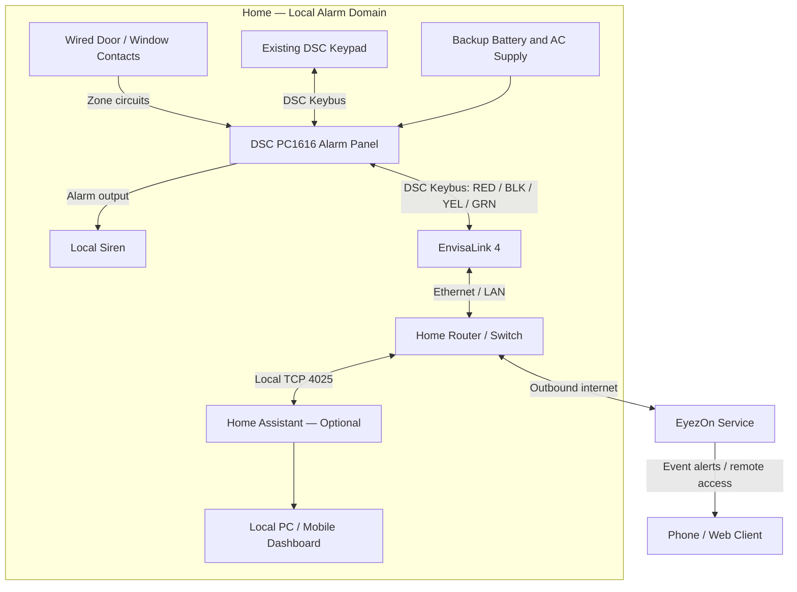

# High-Level Design (HLD)
## DSC PC1616 Smart Home Alarm Monitoring and Control

| Document field | Value |
|---|---|
| Document ID | HLD-HOME-ALARM-001 |
| Version | 1.0 |
| Date | 2026-10-24 |
| Status | Proposed / Pending installation and validation |
| Classification | Private — Home Security Architecture |
| System | DSC PowerSeries PC1616 (v4.23NA) with EnvisaLink 4 |
| Monitoring model | Self-monitored; no professional monitoring provider |

> **Security notice:** This document describes the system architecture and acceptance requirements, not a substitute for the manufacturer's installation instructions. Keep this file private because it describes security infrastructure. Electrical connections should be performed with both AC and backup battery isolated by a qualified alarm technician.

## 1. Executive Summary

The project extends an existing DSC PowerSeries PC1616 wired home alarm with network connectivity through an EnvisaLink 4 (EVL-4) interface. The existing alarm panel, keypad, wired door/window contacts, and siren remain the authoritative local security system. EyezOn provides supported remote access and event notifications. An optional Home Assistant deployment provides local dashboards, event history, and custom automations.

The primary design objective is to add phone and computer visibility **without making the alarm dependent on the internet, a cloud service, or a general-purpose computer**.

## 2. Scope

### 2.1 In Scope

- Preserve existing DSC PC1616 alarm functionality and wired zones.
- Integrate EnvisaLink 4 with the DSC Keybus and wired home LAN.
- Configure EyezOn self-monitoring and alarm/arm/disarm notifications.
- Support authorized remote status inspection and, if enabled, arm/disarm operations.
- Optionally integrate Home Assistant for local dashboard, zone history, and automations.
- Test local alarm continuity during internet/network interruptions.

### 2.2 Out of Scope

- Professional central-station monitoring or emergency dispatch.
- Replacing the DSC controller or existing sensors.
- Installing cameras, smart locks, or new wireless sensors.
- Exposing local alarm management ports to the public internet.
- Guaranteeing alert delivery when power, internet, cloud services, or mobile push infrastructure fail.

## 3. Current-State System

The following hardware has been identified from photographs supplied by the homeowner:

| Component | Current state |
|---|---|
| Alarm control panel | DSC PowerSeries PC1616 |
| Firmware | v4.23NA (as labeled) |
| Keypad | DSC wired keypad |
| Intrusion sensors | Existing wired door/window contacts; exact zone map not yet verified |
| Local annunciation | Existing alarm/siren equipment; operation to be validated |
| Backup power | 12 V alarm backup battery; capacity/health to be checked |
| Monitoring provider | None |
| Network interface | EnvisaLink 4 owned; installation/configuration status not confirmed |

**Assumptions to verify:** The PC1616's Keybus is healthy, the EnvisaLink hardware is functional and supported by the current integration, the home has an Ethernet path to the router, and the user has valid alarm access credentials.

## 4. Target Architecture

**Architectural boundary:** The DSC PC1616 is the sole authority for zone interpretation, entry/exit delays, alarm state, and siren actuation. EnvisaLink observes and sends supported commands via Keybus. Neither EyezOn nor Home Assistant is in the critical path for local alarm activation.

## 5. Component Responsibilities

| Component | Responsibility | Dependency |
|---|---|---|
| Wired contacts | Signal open/closed zone state | Physical zone wiring |
| DSC PC1616 | Zone evaluation, alarm state, entry/exit delays, siren activation | AC/backup power |
| Keypad | Local status and user arm/disarm control | DSC Keybus |
| EnvisaLink 4 | Keybus-to-Ethernet integration, supported status/command interface | Keybus power, LAN |
| Router/switch | LAN connectivity and internet uplink | Network power and ISP |
| EyezOn | Remote service, supported alert delivery and remote UI | Internet and account configuration |
| Home Assistant (optional) | Local dashboard, history, automations | Always-on host and LAN |
| Phone/PC | User interface and notification reception | Network, application access |

## 6. Interfaces and Connectivity

| Interface | Connection | Design notes |
|---|---|---|
| Wired zones | Sensors → PC1616 zone inputs | Preserve existing zone wiring and end-of-line configuration |
| DSC Keybus | PC1616 ↔ keypad and EnvisaLink | Four terminals: RED, BLK, YEL, GRN; EnvisaLink connected in parallel |
| Local network | EnvisaLink ↔ router/switch | Ethernet; reserve IP address via DHCP where possible |
| Home Assistant integration | Home Assistant → EnvisaLink | Local TCP port 4025, configured credentials; restrict to trusted LAN |
| Remote service | EnvisaLink ↔ EyezOn | Supported outbound internet connection; no direct inbound port forwarding |
| Notifications | EyezOn → mobile device | Requires configured alert rules and working push/email delivery |

Actual IP addresses, credentials, MAC addresses, zone labels, and user codes must **not** be committed to this document or a public repository.

## 7. Functional Requirements

| ID | Requirement | Priority | Verification |
|---|---|---|---|
| FR-001 | Preserve existing local alarm arming/disarming | Must | Keypad test |
| FR-002 | Preserve local siren behavior | Must | Controlled alarm test |
| FR-003 | Report alarm trigger events to remote user | Must | Notification test |
| FR-004 | Report arm and disarm events where supported | Must | Notification test |
| FR-005 | Display current alarm status remotely | Must | App/web status test |
| FR-006 | Display individual wired zone status | Should | Open/close each mapped contact |
| FR-007 | Support authorized remote arm/disarm | Should | Permissioned command test |
| FR-008 | Maintain event history | Should | Review portal/optional HA history |
| FR-009 | Support optional local automations | Could | HA automation test |
| FR-010 | Indicate communications failure or loss of service | Should | Controlled outage test |

## 8. Non-Functional Requirements

| ID | Category | Requirement |
|---|---|---|
| NFR-001 | Availability | Local intrusion detection and siren must remain functional without LAN/internet/HA, subject to panel power and hardware health. |
| NFR-002 | Security | Require strong unique account and local interface credentials; enable MFA where available. |
| NFR-003 | Network | No public inbound port forwarding to the EnvisaLink management or integration ports. |
| NFR-004 | Reliability | Remote alert delivery is best-effort and must not be treated as emergency dispatch. |
| NFR-005 | Privacy | Limit exposure of zone names, occupancy patterns, logs, and system details. |
| NFR-006 | Maintainability | Maintain a private zone map, firmware inventory, backup/restore notes, and test records. |
| NFR-007 | Safety | Electrical work must follow manufacturer guidance; isolate AC and backup battery before modifications. |

## 9. Primary Event Flows

### 9.1 Intrusion Alarm Trigger

1. A wired contact changes state.
2. The PC1616 evaluates zone type, arming mode, and any programmed delay.
3. If alarm conditions are met, the PC1616 activates the local alarm output.
4. EnvisaLink receives the relevant panel event over Keybus.
5. With working network and service connectivity, EyezOn processes the event.
6. A configured notification is sent to the user's phone or email.
7. If Home Assistant is enabled, it may independently record the alarm state locally.

### 9.2 Arm / Disarm

1. User enters a valid code at the keypad or submits an authorized remote command.
2. The PC1616 processes the request and updates its state.
3. EnvisaLink reports the state transition.
4. EyezOn and/or Home Assistant display the state and deliver configured alerts.

### 9.3 Network Failure

1. Router, ISP, or cloud connectivity becomes unavailable.
2. EyezOn remote access and alerts may be delayed or unavailable.
3. PC1616 keypad, sensors, and local siren continue operating independently if the panel remains powered and healthy.
4. On restoration, verify module connectivity and event reporting; do not assume every missed event will be replayed.

## 10. Security Architecture

- **Trust boundaries:** Physical alarm domain, trusted home LAN, optional local automation host, external EyezOn cloud, remote user device.
- **Authentication:** Change default EnvisaLink local credentials; use a unique EyezOn password; protect phone and PC access.
- **Authorization:** Limit remote arm/disarm access to approved users; prefer monitoring-only access where control is unnecessary.
- **Network hardening:** Use DHCP reservation; permit integration access only from trusted devices; never directly expose TCP 4025 or local management UI to the internet.
- **Secrets:** Keep alarm codes, account credentials, and module MAC identifiers out of source control and shared diagrams.
- **Automation safety:** Avoid automatic disarming based solely on presence, geofencing, or an unverified sensor event.
- **Physical security:** Secure the alarm cabinet and Ethernet equipment against tampering.

## 11. Availability and Failure Analysis

| Failure | Local alarm | Remote alerts | Mitigation |
|---|---|---|---|
| ISP outage | Normally continues | Unavailable/delayed | Maintain local siren; consider independent backup connectivity later |
| Router outage | Normally continues | Unavailable/delayed | Router UPS; network health checks |
| Home Assistant outage | Continues | EyezOn path unaffected | Keep HA optional |
| EyezOn outage | Continues | Unavailable/delayed | Do not rely on cloud as sole security response |
| EnvisaLink failure | Normally continues | EnvisaLink-dependent access unavailable | Verify keypad and panel operation after installation |
| AC power failure | Continues while battery supports load | Depends on network power | Check battery; UPS for router/modem |
| DSC panel failure | May fail | May fail | Periodic maintenance and supervised tests |

## 12. Deployment Plan

### Phase 1 — Pre-installation

- Record baseline keypad operation, current trouble indicators, and working zones.
- Confirm PC1616/EVL-4 compatibility and installation guidance.
- Check Ethernet route, router port, and backup power condition.
- Identify whether the panel is connected to any external dialer or third-party equipment.

### Phase 2 — Physical Installation

- Have a qualified alarm technician isolate both AC transformer and backup battery.
- Install EVL-4 in an approved position and connect its RED/BLK/YEL/GRN Keybus terminals in parallel with existing keypad wiring.
- Connect Ethernet to the trusted LAN.
- Restore power and verify keypad, panel, and EnvisaLink status indicators.

### Phase 3 — Network and EyezOn Configuration

- Locate the EnvisaLink IP through router DHCP leases.
- Reserve a stable DHCP address and change default local credentials.
- Register/activate the module with EyezOn according to its instructions.
- Enable desired alarm, arm, disarm, and trouble notifications.

### Phase 4 — Optional Home Assistant

- Deploy Home Assistant on a suitable always-on host.
- Configure the EnvisaLink integration with DSC panel type, local host/IP, credentials, partition, and zone map.
- Build a local dashboard and only then add optional automations.

### Phase 5 — Validation and Handover

- Perform controlled zone, keypad, siren, remote notification, and outage tests.
- Record results, outstanding issues, and operational instructions.

## 13. Acceptance Test Plan

| Test ID | Scenario | Expected result |
|---|---|---|
| AT-001 | Arm/disarm at existing keypad | Works as before integration |
| AT-002 | Open each monitored door/window with system disarmed | Correct zone changes state; no unintended alarm |
| AT-003 | Controlled alarm trigger with appropriate precautions | Siren activates per DSC programming; configured remote alert received when online |
| AT-004 | Arm and disarm events | Configured state notifications received |
| AT-005 | Disconnect internet temporarily | Local alarm remains operational |
| AT-006 | Stop Home Assistant | Local alarm and EyezOn path remain functional |
| AT-007 | Attempt unauthenticated local interface access | Access denied |
| AT-008 | Verify router configuration | No public port forwarding to EVL-4 |
| AT-009 | Restore internet | Remote status and new notifications resume |
| AT-010 | Check backup battery/trouble indications | No unresolved panel trouble after deployment |

**Testing precaution:** Warn household occupants and nearby neighbors before any siren test. Use a controlled test procedure and never assume an alert guarantees emergency response.

## 14. Open Decisions and Risks

| ID | Item | Status |
|---|---|---|
| OD-001 | EVL-4 physical installation and firmware state | To verify |
| OD-002 | Ethernet availability at alarm cabinet | To verify |
| OD-003 | Final zone-to-door/window mapping | To verify |
| OD-004 | EyezOn account and preferred notification channels | To configure |
| OD-005 | Whether Home Assistant is required | Optional decision |
| OD-006 | Home Assistant hosting device and uptime expectations | If HA selected |
| OD-007 | Backup power for router/modem | Recommended assessment |
| OD-008 | Desired remote arm/disarm permissions | To decide |

## 15. Operational Model

The homeowner is the operator and alert recipient. There is no professional monitoring or guaranteed dispatch. Routine operation includes periodic keypad checks, sensor testing, battery inspection, confirmation of alert delivery, and review of account access. After network or firmware changes, rerun relevant acceptance tests.

## 16. References

- [EyezOn EnvisaLink 4 Quick Start / Installation Guide](https://www.eyezon.com/Envisalink4MQuickStartFull.pdf)
- [EyezOn Official Website](https://www.eyezon.com/)
- [Home Assistant — Envisalink Integration](https://www.home-assistant.io/integrations/envisalink/)

---

**Approval status:** Draft for homeowner review. The architecture is based on the identified DSC PC1616 and owned EnvisaLink 4; installation details, network environment, zone mapping, and alert delivery remain subject to onsite validation.
